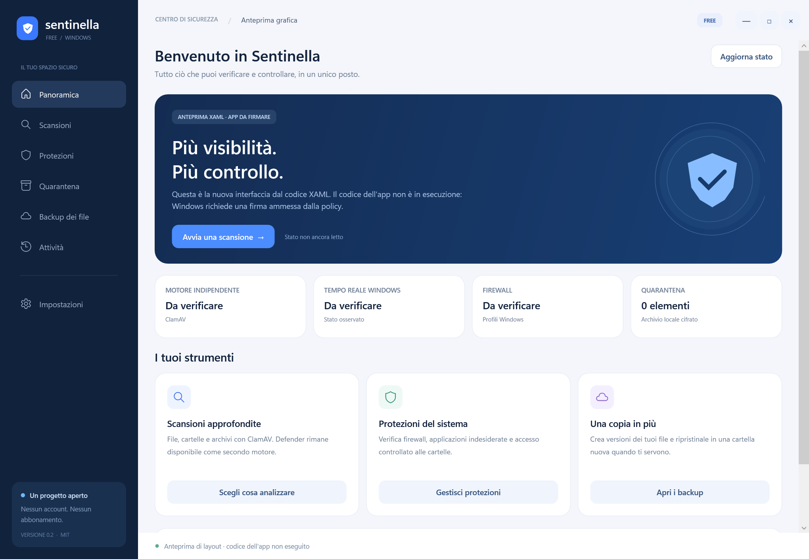

# Sentinella Free

Experimental Windows security software with a WPF interface, a local ClamAV adapter, optional Microsoft Defender integration, encrypted manual quarantine and versioned local backups.

**Status: unsigned development version 0.3.** Windows Smart App Control blocked the new GUI on the development machine. Publishing this repository does not remove that block. No signing provider has accepted the project and integrated GUI validation remains pending. [Code signing policy](CODE_SIGNING.md).

No equivalence or superiority compared with established antivirus products is claimed. There is no autonomous Windows on-access prevention driver, independent exploit prevention, browser/web filtering or VPN.

## Interface



This is the 0.2 XAML layout preview, before the application-control panel was added, with event handlers removed; it is not a screenshot proving successful application execution. States shown as unverified have not been read by that preview.

## Application control (0.3 development)

The new Protections > Manage authorizations window authors a per-user AppLocker allowlist, tests candidate rules offline, and provides explicitly confirmed UAC actions for audit, enforcement and guarded restore. Windows is the base allowed location; allowing all of Program Files is a separate opt-in. Approvals use Windows Authenticode hashes and are rechecked against full file hashes before deployment. This does not override Smart App Control. Scripts, DLLs, macros, installers and execution inside approved hosts are outside this first version. Elevated deployment and actual blocking/restore have not been exercised end-to-end. See [APP_CONTROL.md](APP_CONTROL.md).

## Implemented modules

- ClamAV scanning of files, folders and archives from explicit engine/database paths, with errors, encrypted content and scan limits kept distinct from confirmed detections.
- FreshClam official database updates without disabling database authentication. The engine and databases are separate upstream components, not included in this source repository.
- Manual quarantine rechecks a read-locked snapshot with ClamAV and verifies the original hash before removal. AES-GCM and Windows DPAPI protect the archive; restore never overwrites existing files.
- User-supplied exact SHA-256 rules. No local match does not imply a safe file.
- Versioned local folder backups with SHA-256 checks and restore into a new destination. These copies are not offline or immutable ransomware protection.
- Windows antivirus/provider, firewall, startup and TCP inventory. Five closed-list policy actions require an explicit user click and Windows elevation. Configured settings are not treated as proof of operational protection.
- Folder monitoring detects changes after a write. It does not block execution or automatically isolate files.

## Build

Windows x64, PowerShell and .NET SDK 10:

```powershell
./build.ps1
```

Unsigned output: `artifacts/unsigned`. The script checks the common product/version metadata and writes `original-components.json`. It does not launch the app, apply a signature or modify protection settings.

The [Windows workflow](.github/workflows/windows.yml) compiles the project on an isolated runner, runs read-only application-control checks and saves an unsigned review artifact. It uses read-only repository permissions, action commits pinned by SHA and no signing credentials. A green build is not proof of complete antivirus efficacy or an integrated functional pass.

For local engine operation, obtain the official ClamAV distribution according to its upstream instructions. The app expects `runtime/clamav` and `runtime/database` alongside the executable, or explicit `--runtime-root` and `--state-root` paths for isolated development. FreshClam can populate official databases once the engine is available. Harmless test signatures are not a full official database.

## Tests

Source includes separate console suites for the original scanner/quarantine, ClamAV adapter, Windows policy validation/read-only audit and local backup/restore. Detection tests use a harmless custom marker and benign ZIP archives, never live malware. Privileged Windows modifications are not executed by the tests. Symlink checks explicitly skip where the required privilege is absent.

Module checks passed during development, but the workflow also runs read-only application-control tests. Tests must run in an appropriately permitted environment; do not work around a computer's execution policy to run them. Integrated GUI startup and a complete efficacy evaluation remain pending.

## Maintenance and signing

Initial repository owner/maintainer: [gabryrinaldi4-a11y](https://github.com/gabryrinaldi4-a11y).

See [CODE_SIGNING.md](CODE_SIGNING.md), [PRIVACY.md](PRIVACY.md) and [SECURITY.md](SECURITY.md). A future free-signing application is subject to provider requirements and approval; there is no automatic entitlement for a new project. No signed release is announced until the signature and subsequent tests have actually succeeded.

## License and third-party boundaries

Original source: [MIT](LICENSE.txt). Microsoft .NET and ClamAV retain their own licenses and ownership. No Bitdefender or Malwarebytes binaries, drivers, signatures, proprietary resources, reverse-engineering evidence, credentials or personal machine logs are included.

## Italiano

Sentinella è un progetto sperimentale. I sorgenti pubblici rendono verificabili codice e build, ma non garantiscono una firma gratuita, l'avvio su ogni computer o la parità con antivirus commerciali. La nuova GUI deve ancora superare il collaudo integrato dopo una distribuzione legittimamente ammessa da Windows.
